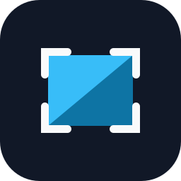

<p align="center">
  
</p>

# Snapshade

Press a hotkey, drag a region, annotate it in place, copy it. A fast, local-only screenshot
tool for macOS and Windows.

Nothing ever leaves your machine: **Snapshade has no networking code at all**. No upload, no
accounts, no telemetry, no update checks.

## Why it exists

The screenshot tool I had used for years, Lightshot, is only available for the Mac through the
App Store, and installing from the App Store is blocked on my work laptop. I needed a good
screenshotter that installs from a plain disk image, so I built one with the same instant
loop: hotkey, drag, annotate, copy. Snapshade is an independent project and is not affiliated
with Lightshot or its publisher.

## Features

- **Instant.** The overlay appears on the frozen frame in well under 100 ms, on every display at once.
- **Annotate in place.** Pen, line, arrow, rectangle, circle, marker, blur, text and colour, with undo.
- **Copy, save, print.** Clipboard in one key, instant save to your folder, Save As with PNG / JPG / BMP, or the system print dialog.
- **Quick copy.** Hold ⌘ (Ctrl on Windows) when you start the drag and the selection is copied the moment you release.
- **Multi-monitor and HiDPI.** Physical pixels everywhere; mixed-DPI setups and Retina displays just work.
- **Small and native.** Rust core, system webview for the overlay, about 2.5 MB on macOS and 1.5 MB on Windows.
- **Private by construction.** The binary contains no HTTP client. Settings are one JSON file on your disk.

## Install

Download the latest build from the [Releases](https://github.com/aqueeb/snapshade/releases) page.

### macOS 14 Sonoma or later

1. Open `Snapshade_<version>_aarch64.dmg` and drag **Snapshade** to **Applications**. Launch it
   from Applications, not from the disk image (macOS ties permissions to the app's location).
2. Press ⇧⌘9 once. macOS asks for **Screen Recording** permission; Snapshade also opens a small
   guidance window with an **Open System Settings** button.
3. Enable Snapshade under **System Settings → Privacy & Security → Screen & System Audio
   Recording**, then use **Quit and relaunch** in the guidance window. macOS only applies the
   grant to a fresh process.
4. Press ⇧⌘9 again. The screen dims and you can drag.

The app is signed with a Developer ID, hardened-runtime, notarized and stapled, so Gatekeeper
accepts it without any right-click tricks. If you ever see "damaged" or "can't be opened", the
download was altered in transit; download it again.

### Windows 10 1903 or later, Windows 11

Run `Snapshade_<version>_x64-setup.exe`. It installs for the current user, needs no admin
rights, and puts Snapshade in the system tray. Press **PrintScreen** to capture.

The installer, `snapshade.exe` and the uninstaller carry a publicly trusted code signature
(right-click → Properties → Digital Signatures shows the publisher, Syed Aqueeb Qadri). The
publisher is new to SmartScreen, so until enough installs have accumulated Windows may still
say "Windows protected your PC": check that the publisher under *More info* matches, then
*Run anyway*.

On Windows 11, if the PrintScreen key is bound to Snipping Tool, Snapshade shows a notification
that opens the setting (Settings → Accessibility → Keyboard → "Use the Print screen key to open
screen capture"); the tray menu's **Take a screenshot** always works regardless.

## Using it

| | macOS | Windows |
|---|---|---|
| Start a capture | **⇧⌘9** (configurable) | **PrintScreen** (configurable) |
| Copy selection | ⌘C, or the Copy button | Ctrl+C |
| Quick copy | hold ⌘ while you **start** the drag → copied on release, no toolbar | hold Ctrl |
| Save instantly to the last folder | ⌘S | Ctrl+S |
| Save As… (PNG / JPG / BMP) | Save button | Save button |
| Print | ⌘P / Print button | Ctrl+P |
| Select the whole display | ⌘A, double-click, or right-click → Fullscreen | Ctrl+A |
| Nudge / resize selection | arrows / ⇧+arrows (1 px) | same |
| Undo last annotation | ⌘Z / Undo button | Ctrl+Z |
| Change tool size | mouse wheel, or ⌘+ / ⌘- | wheel, Ctrl+ / Ctrl- |
| Cancel | Esc, ⌘X, or the Close button | Esc, Ctrl+X |

Tools (vertical strip, right of the selection): Pen, Line, Arrow, Rectangle, Circle, Marker,
Blur, Text, Color, Undo. Actions (horizontal strip, below): Print, Copy, Save, Close. The W×H
badge shows the selection size in physical pixels.

**Options** (from the tray / menu-bar icon) has three tabs: General (notifications, include the
mouse cursor, remember the selected area, start at login, language), Hotkeys (the capture
hotkey and an optional instant full-screen save hotkey, each with a key recorder) and Formats
(default format, JPEG quality, PNG optimisation, default save folder). The full behaviour is
written down in [docs/SPEC.md](docs/SPEC.md).

## Privacy

Snapshade opens no network connections and has no code that could. **Help** and **About →
GitHub** hand a URL to your default browser; that is the operating system doing the browsing.
Screenshots go to your clipboard or the folder you chose. Settings live in
`~/Library/Application Support/io.github.aqueeb.snapshade/settings.json` on macOS and
`%APPDATA%\io.github.aqueeb.snapshade\settings.json` on Windows.

## Updating

There is no auto-update, by design. Install a newer release over the old one:

- **macOS:** quit Snapshade from the menu-bar icon, drag the new app to Applications and choose
  Replace, launch it. The Screen Recording grant and the login item survive because every
  release is signed by the same Developer ID with the same bundle identifier.
- **Windows:** run the new installer. It offers to uninstall the previous version first (the
  default), stops a running Snapshade when you confirm, and keeps your settings and the
  start-at-login entry. A silent upgrade is `Snapshade_<version>_x64-setup.exe /S`.

## Building from source

Requirements: Rust 1.90+, [bun](https://bun.sh), and on macOS the Xcode command-line tools,
on Windows the Visual Studio Build Tools with the Windows 10/11 SDK.

```sh
bun install
bun run build                                    # webview bundles
cargo build -p snapshade                         # debug binary
scripts/sign-and-run.sh target/debug/snapshade   # macOS: sign with your dev identity and run
bun run tauri build --bundles app,dmg            # macOS release .app + .dmg
bun run tauri build --bundles nsis               # Windows installer
```

On macOS a development build needs a stable code signature for the Screen Recording grant to
stick: set `SNAPSHADE_SIGN_IDENTITY` to your "Apple Development: …" identity and
`SNAPSHADE_TEAM_ID` to its Team ID before `scripts/sign-and-run.sh`. Release signing,
notarization and the Windows signing pipeline are described in [docs/RELEASING.md](docs/RELEASING.md).

Tests: `cargo test --workspace`, `bun run --cwd ui test` (TypeScript tests including golden
images), `cargo clippy --workspace --all-targets -- -D warnings`, `cargo fmt --all --check`.

Useful dev hooks: `SNAPSHADE_OPEN_WINDOW=options|about|permission` opens that window at
startup; `SNAPSHADE_AUTO_DISMISS_MS=<ms>` dismisses the overlay automatically (for automation);
`SNAPSHADE_SELFTEST=preflight|<N>|exclusion` runs the in-process self-tests.

## Project layout

```
crates/core             pure Rust core (geometry, topology, encoders, hotkey model, settings, file names)
crates/platform-api     the platform traits (displays, capture, overlay, clipboard, print, shell, notify)
crates/platform-macos   AppKit / ScreenCaptureKit / UserNotifications adapters
crates/platform-windows DXGI + GDI capture / Win32 clipboard / WinRT toast adapters
crates/platform-fake    headless test platform
src-tauri               the app: tray, hotkeys, overlay hosts, export, Options, settings
ui                      the webview layer: pure TS core (selection, annotations, render) + overlay/Options pages
docs                    behaviour spec, release process
```

## Contributing and support

Bug reports and pull requests are welcome; see [CONTRIBUTING.md](CONTRIBUTING.md). Questions
go in GitHub Issues. Security concerns: [SECURITY.md](SECURITY.md).

## License

MIT, see [LICENSE](LICENSE). Snapshade is an independent open-source project and is not
affiliated with, endorsed by, or derived from Lightshot or its publisher.
